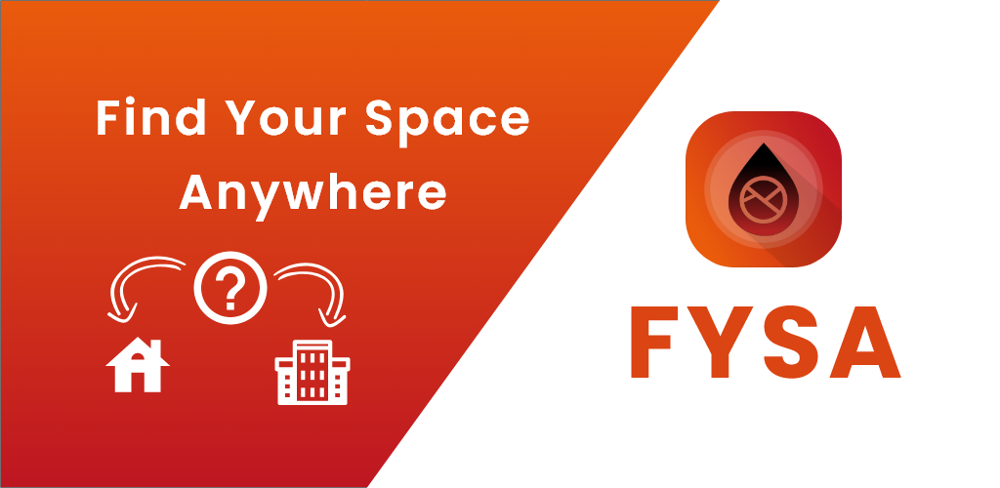

# FYSA — Space Discovery & Booking Android Application


**FYSA** (`com.skar.fysa`) is a native Android mobile application designed for seamless space discovery, space management, and booking analytics. It connects users looking for available spaces with space owners through real-time map discovery, interactive dashboards, and cloud-backed booking management.

---

## Key Features

### 1. Space Discovery & Map Integration
- **Dual-Map Support:** Browse and locate available spaces interactively using **Google Maps** and **OpenStreetMap (`osmdroid`)**.
- **Search & Filtering:** Filter spaces by availability, location, category, and pricing.
- **Detailed Space Listings:** View high-resolution space photos, amenities, location pins, and real-time availability status.

### 2. Space Management (Host / Owner Tools)
- **Create & Edit Listings:** Space owners can publish new spaces, upload images via **Firebase Storage**, and update pricing or availability on the fly.
- **Booking Requests:** Manage incoming reservations, approve or decline requests, and track active bookings.

### 3. Booking Dashboards & Analytics
- **Interactive Visual Analytics:** Powered by **MPAndroidChart** to display booking trends, occupancy rates, and revenue/activity breakdowns.
- **Booking History:** End-to-end tracking of upcoming, completed, and cancelled reservations.

### 4. Authentication & Cloud Sync
- **Secure User Accounts:** Email/password and user session management powered by **Firebase Authentication**.
- **Real-Time Database & Firestore:** Instant synchronization of space availability, user profiles, and booking states across **Cloud Firestore** and **Firebase Realtime Database**.

---

## Tech Stack

| Layer | Technology |
| :--- | :--- |
| **Language & Core** | Java, Android SDK, Material Design Components |
| **Authentication** | Firebase Authentication |
| **Databases** | Cloud Firestore, Firebase Realtime Database |
| **Media Storage** | Firebase Cloud Storage |
| **Mapping & Geolocation** | Google Maps SDK for Android, OSMdroid |
| **Data Visualization** | MPAndroidChart |
| **Build System** | Gradle |

---

## Project Structure

```text
FYSA/
├── app/
│   ├── src/
│   │   ├── main/
│   │   │   ├── java/com/skar/fysa/
│   │   │   │   ├── activities/      # Main, Auth, Space Detail, and Booking screens
│   │   │   │   ├── fragments/       # Discovery, Map, Space Management, and Dashboard tabs
│   │   │   │   ├── adapters/        # RecyclerView adapters for spaces and bookings
│   │   │   │   ├── models/          # Data models (User, Space, Booking)
│   │   │   │   └── utils/           # Firebase helpers, Map utilities, Chart formatters
│   │   │   ├── res/                 # XML layouts, drawables, navigation menus, themes
│   │   │   └── AndroidManifest.xml
│   └── build.gradle
├── build.gradle
└── settings.gradle
```

---

## Getting Started

### Prerequisites
- **Android Studio** (Hedgehog / Iguana or newer recommended)
- **JDK 17** (or compatible Android Gradle Plugin JDK)
- A **Firebase Project** with Authentication, Firestore, Realtime Database, and Storage enabled
- A **Google Maps API Key** (from Google Cloud Console)

### Installation & Setup

1. **Clone the repository:**
   ```bash
   git clone [https://github.com/skartechrakesh/FYSA.git](https://github.com/skartechrakesh/FYSA.git)
   cd FYSA
   ```

2. **Configure Firebase:**
   - Create a project in the [Firebase Console](https://console.firebase.google.com/).
   - Register an Android app with package name `com.skar.fysa`.
   - Download `google-services.json` and place it inside the `app/` directory:
     ```text
     FYSA/app/google-services.json
     ```

3. **Add Google Maps API Key:**
   - Add your Google Maps API key to `local.properties` or `AndroidManifest.xml`:
     ```properties
     MAPS_API_KEY=your_google_maps_api_key_here
     ```

4. **Build & Run:**
   - Open the project in Android Studio, allow Gradle to sync dependencies, and run on an emulator or physical Android device (API 24+).

---

## Author

**Rakesh Reddy** (`@skartechrakesh`)
- GitHub: [github.com/skartechrakesh](https://github.com/skartechrakesh)